<!-- Spec sheet: generated by github-profile/tools/build.py in the portfolio source. Edit its CONTENT section and re-run rather than editing this file. -->
<!-- spec-sheet:start -->
<div align="center">
<a href="https://armin0001.github.io/">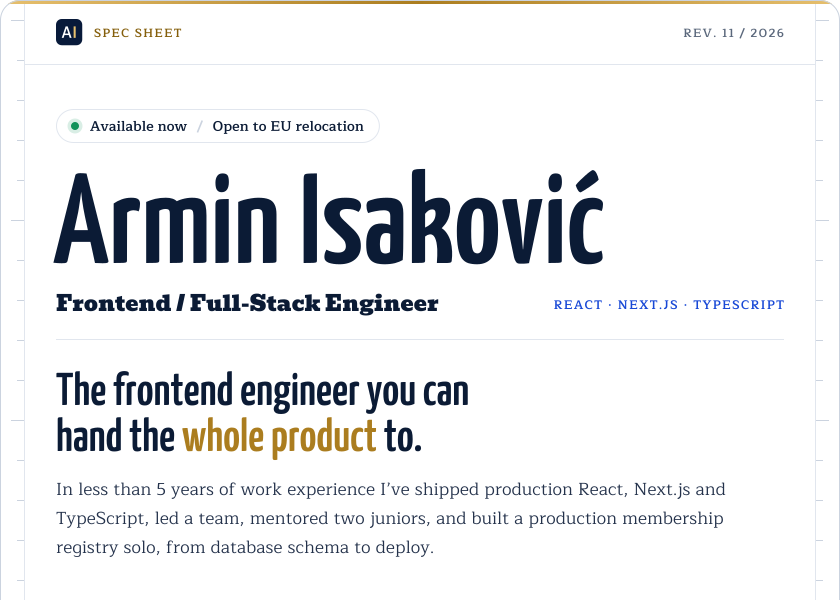</a>
<a href="https://armin0001.github.io/"></a><a href="https://www.linkedin.com/in/armin-isakovic-dev">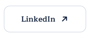</a><a href="https://armin0001.github.io/assets/Armin-Isakovic-Resume.pdf">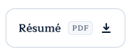</a><a href="mailto:armin.isakovic23@gmail.com?subject=Hello%20Armin%20%E2%80%94%20saw%20your%20GitHub%20profile">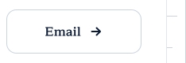</a>
<a href="https://armin0001.github.io/">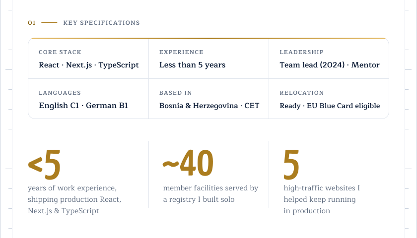</a>
<a href="https://armin0001.github.io/#value-title"></a>
<a href="https://armin0001.github.io/#artifacts">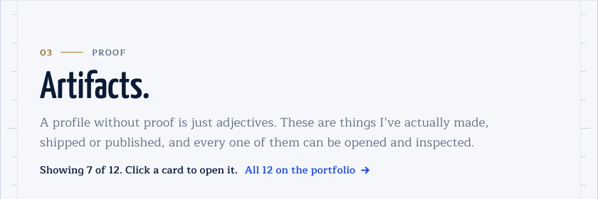</a>
<a href="https://armin0001.github.io/#registry">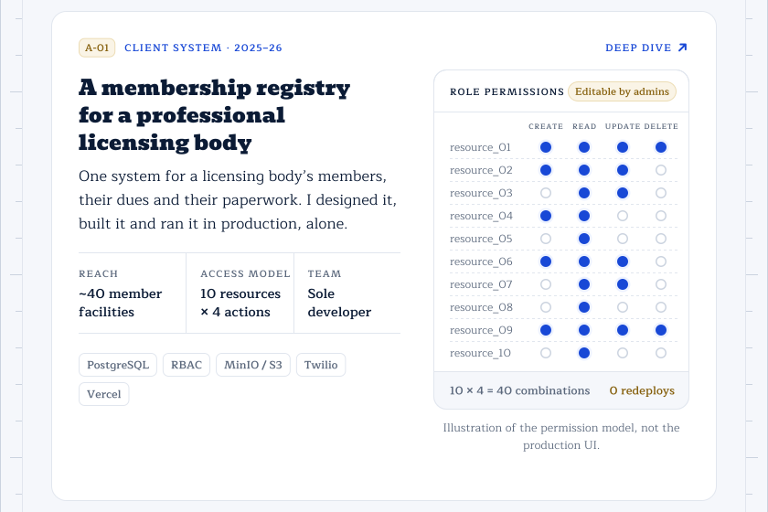</a>
<a href="https://github.com/Armin0001/co2-footprint">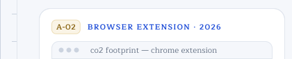</a><a href="https://www.theadvancedcalculator.com">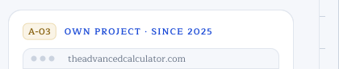</a>
<a href="https://github.com/Armin0001/co2-footprint">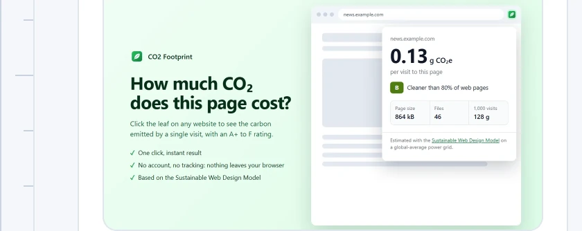</a><a href="https://www.theadvancedcalculator.com">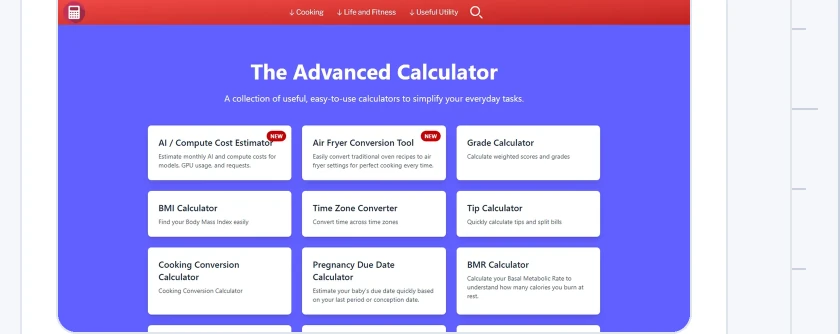</a>
<a href="https://github.com/Armin0001/co2-footprint">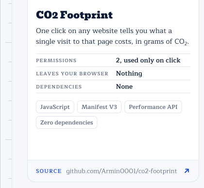</a><a href="https://www.theadvancedcalculator.com">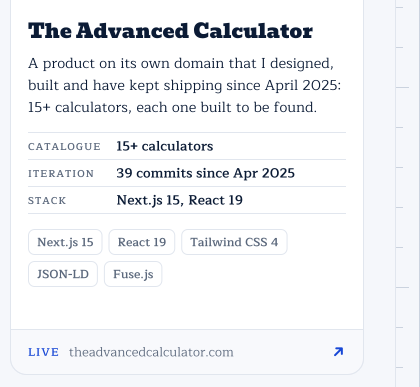</a>
<a href="https://github.com/Armin0001/Online-Ticket-Booth">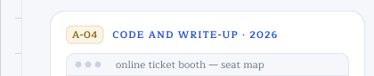</a><a href="https://github.com/Armin0001/excalidraw-ai">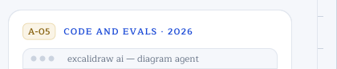</a>
<a href="https://github.com/Armin0001/Online-Ticket-Booth">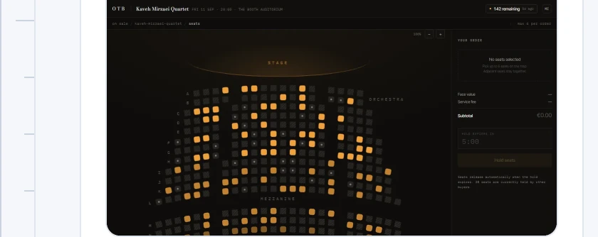</a><a href="https://github.com/Armin0001/excalidraw-ai">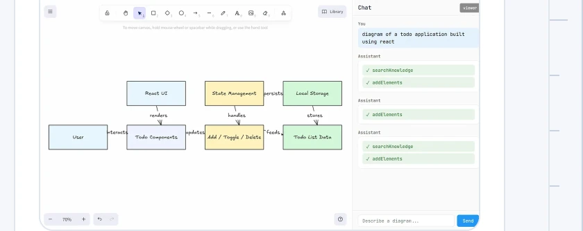</a>
<a href="https://github.com/Armin0001/Online-Ticket-Booth">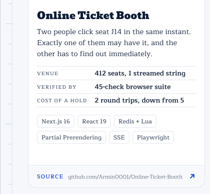</a><a href="https://github.com/Armin0001/excalidraw-ai">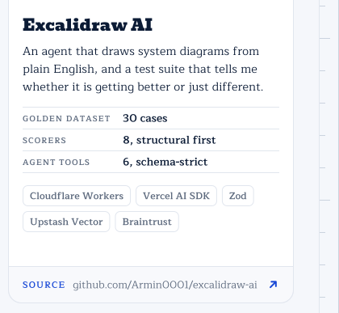</a>
<a href="https://ether-perfume-qtox.vercel.app">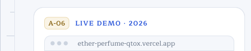</a><a href="https://drift-self-sigma.vercel.app">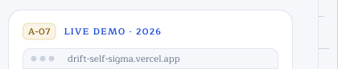</a>
<a href="https://ether-perfume-qtox.vercel.app">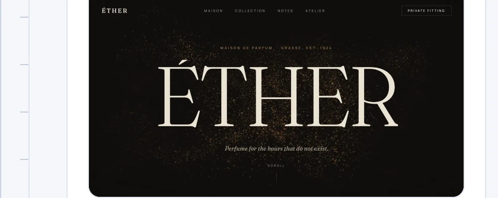</a><a href="https://drift-self-sigma.vercel.app">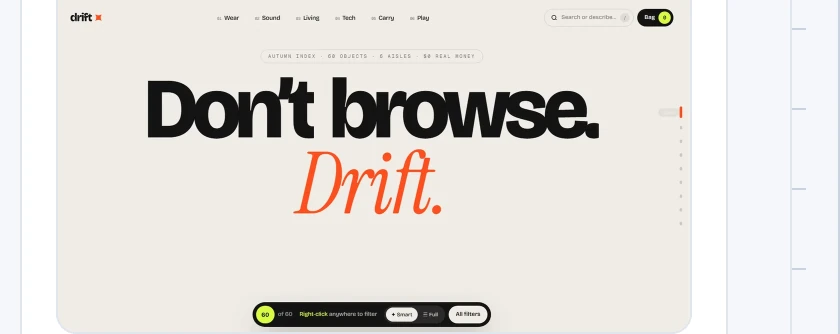</a>
<a href="https://ether-perfume-qtox.vercel.app">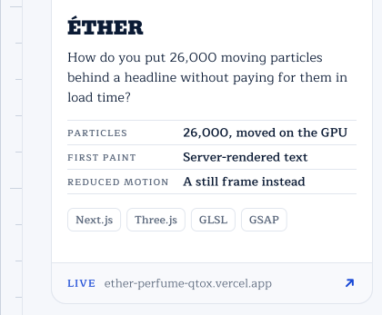</a><a href="https://drift-self-sigma.vercel.app">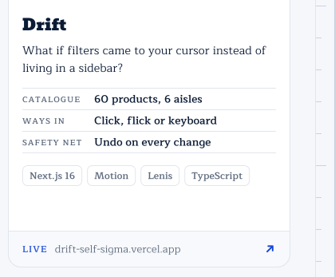</a>
<a href="https://armin0001.github.io/how-i-build.html"></a>
<a href="https://armin0001.github.io/#experience">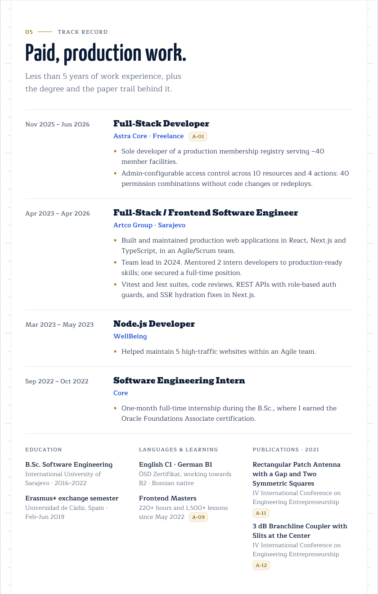</a>
<a href="https://armin0001.github.io/#stack"></a>
<a href="https://armin0001.github.io/#fast-lane"></a>
<a href="mailto:armin.isakovic23@gmail.com?subject=Hello%20Armin%20%E2%80%94%20saw%20your%20GitHub%20profile">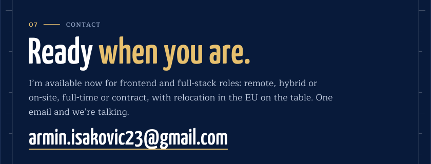</a>
<a href="https://armin0001.github.io/assets/Armin-Isakovic-Resume.pdf"></a><a href="mailto:armin.isakovic23@gmail.com?subject=Hello%20Armin%20%E2%80%94%20saw%20your%20GitHub%20profile"></a><a href="https://www.linkedin.com/in/armin-isakovic-dev"></a><a href="https://frontendmasters.com/u/Armin0001/"></a>
<a href="https://armin0001.github.io/">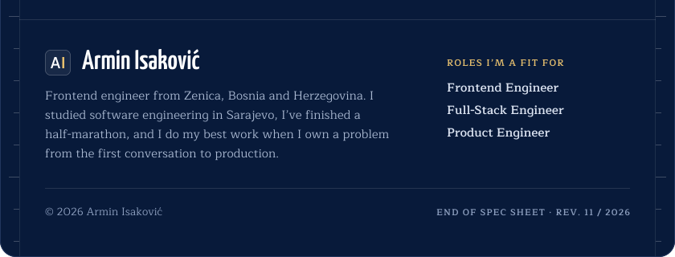</a>
</div>
<!-- spec-sheet:end -->

<details>
<summary><b>Recruiter Fast Lane:</b> copy-ready summary</summary>

```text
Armin Isaković, Frontend / Full-Stack Engineer. Less than 5 years of work experience,
shipping production React, Next.js and TypeScript; team lead in 2024 and mentor to two
junior developers. English C1, German B1. Based in Bosnia and Herzegovina (CET), EU Blue
Card eligible and ready to relocate. Available now. armin.isakovic23@gmail.com,
linkedin.com/in/armin-isakovic-dev
```

</details>
