<!-- Character sheet: generated by github-profile/tools/build.py from the "GitHub README — RPG Character Sheet" design. Edit its DATA section and re-run rather than editing this file. -->

<a href="https://armin0001.github.io/">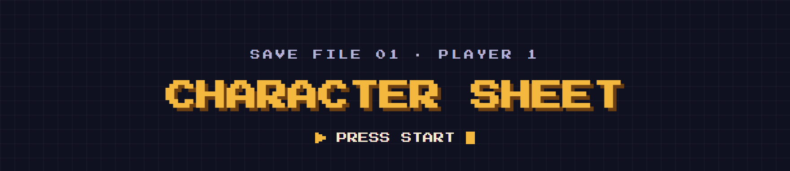</a>
<a href="https://armin0001.github.io/">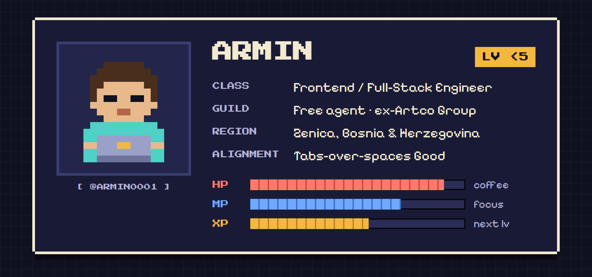</a>
<a href="https://armin0001.github.io/">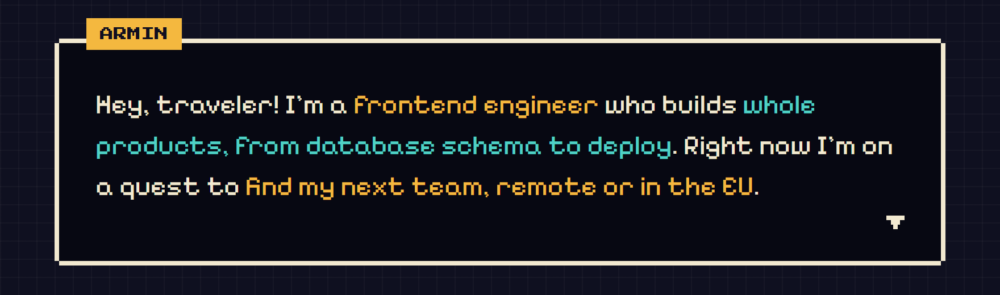</a>
<a href="https://github.com/Armin0001?tab=repositories">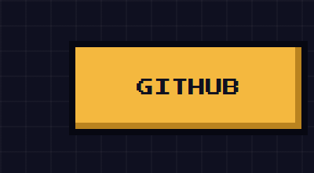</a><a href="https://www.linkedin.com/in/armin-isakovic-dev">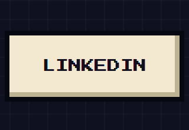</a><a href="https://armin0001.github.io/">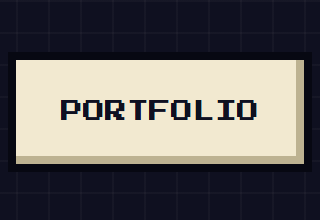</a><a href="https://armin0001.github.io/assets/Armin-Isakovic-Resume.pdf">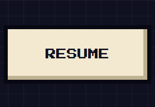</a><a href="mailto:armin.isakovic23@gmail.com?subject=Hello%20Armin%20%E2%80%94%20saw%20your%20GitHub%20profile">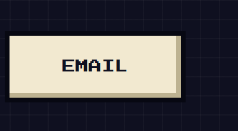</a>
<a href="https://armin0001.github.io/how-i-build.html">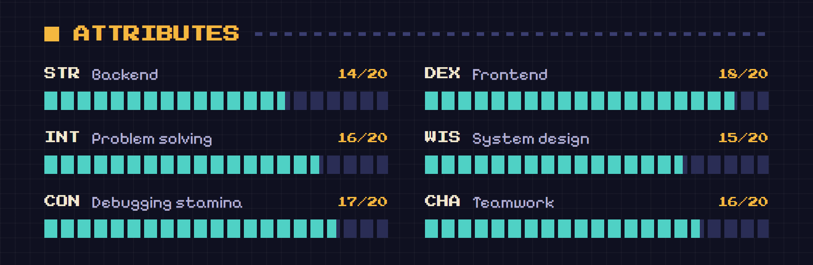</a>
<a href="https://armin0001.github.io/#stack">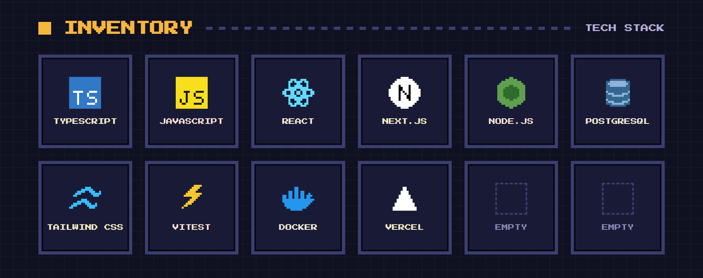</a>
<a href="https://armin0001.github.io/#artifacts">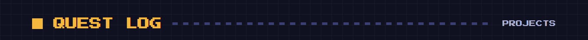</a>
<a href="https://www.theadvancedcalculator.com">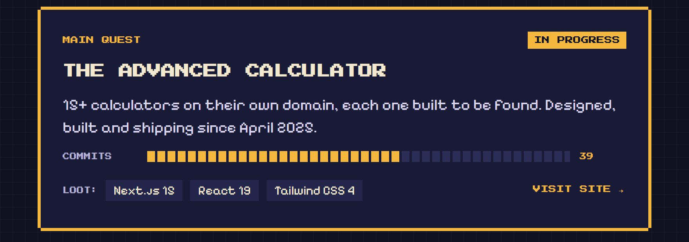</a>
<a href="https://github.com/Armin0001/Online-Ticket-Booth">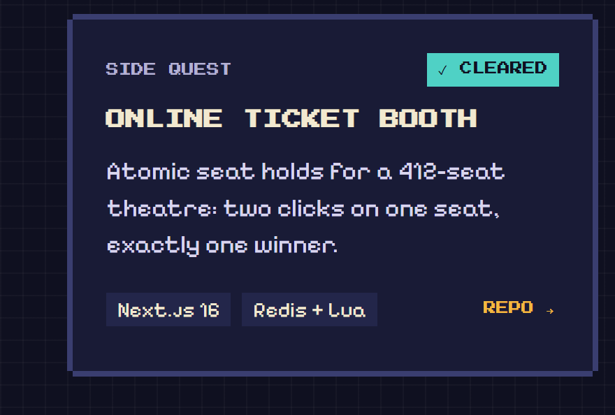</a><a href="https://github.com/Armin0001/excalidraw-ai">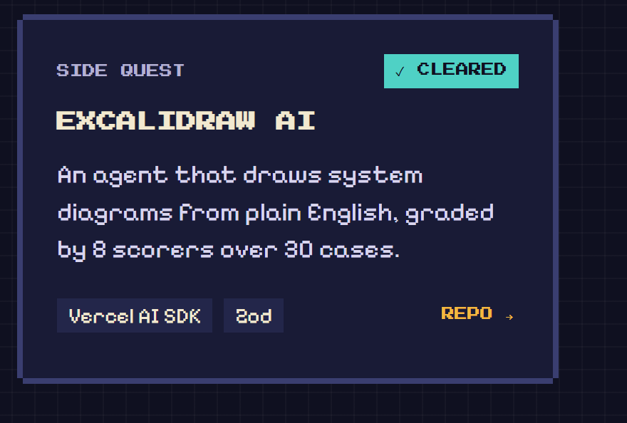</a>
<a href="https://github.com/Armin0001?tab=repositories">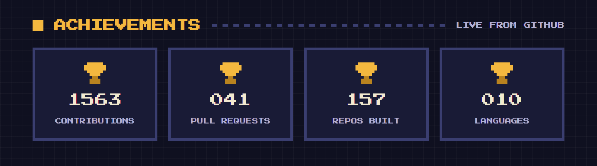</a>
<a href="https://github.com/Armin0001">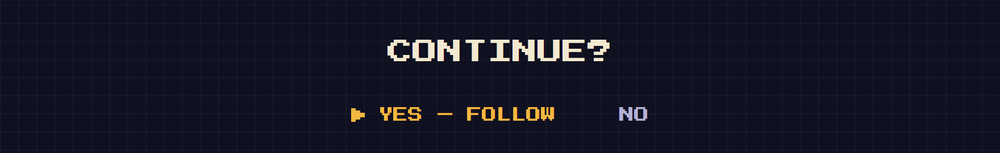</a>
<a href="mailto:armin.isakovic23@gmail.com?subject=Hello%20Armin%20%E2%80%94%20saw%20your%20GitHub%20profile">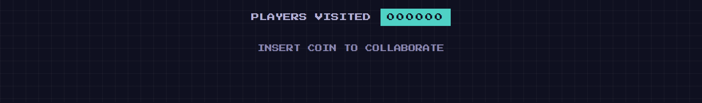</a>

